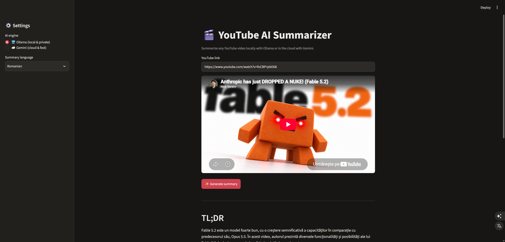
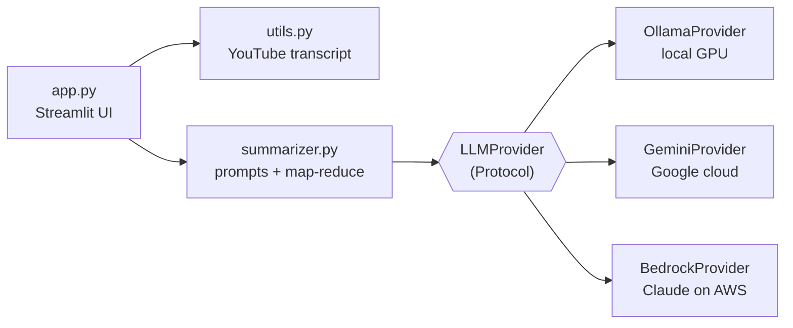

# 🎬 Hybrid YouTube AI Summarizer

[](https://github.com/Liviu1342/hybrid-youtube-ai-summarizer/actions/workflows/tests.yml)

Turn any YouTube video into structured study notes — **100% locally and privately with Ollama**, or **in the cloud with Google Gemini or Claude on Amazon Bedrock**, switchable with one click.



## ✨ Features

- **Structured output** – TL;DR, main ideas and key concepts explained simply, in English or Romanian.
- **Robust URL parsing** – supports `watch?v=`, `youtu.be`, Shorts, embeds and live links.
- **Friendly error handling** – clear messages for missing subtitles, private videos, unavailable models or network issues.
- **Prompt-injection guard** – the transcript is passed to the model as delimited data, never as instructions.
- **Markdown export** – download the summary as a `.md` file.
- **Three interchangeable AI engines** – Ollama (local), Gemini and Claude Sonnet on Amazon Bedrock (cloud), all behind one `LLMProvider` interface.
- **Live streaming** – the summary appears word by word as the model writes it.
- **Long videos (map-reduce)** – transcripts longer than ~24,000 characters are split into chunks, each chunk is condensed into notes (map), and the final summary is written from all the notes (reduce), so nothing past the first minutes is lost.

## 🏗️ Architecture



The UI depends only on the `LLMProvider` contract. Providers are created in a single factory (`build_provider`) and injected into `generate_summary`, so adding a new provider means writing one class — no UI changes.

Very long transcripts go through a map-reduce step first: `split_into_chunks` cuts the text between words, `summarize_chunks` turns each chunk into short notes, and the usual summary prompt runs on the joined notes.

## 🛠️ Tech stack

Python 3.10+ · Streamlit · youtube-transcript-api · Ollama (`llama3.1:8b`) · Google Gen AI SDK (Gemini) · Anthropic SDK (Claude on Amazon Bedrock) · python-dotenv

## 🚀 Getting started

### Prerequisites

- Python 3.10 or newer
- [Ollama](https://ollama.com/download) for local mode: `ollama pull llama3.1:8b`
- *(Optional)* a Gemini API key from [Google AI Studio](https://aistudio.google.com/apikey) for cloud mode
- *(Optional)* AWS access keys for an IAM user allowed to invoke Claude on Amazon Bedrock

### Installation

```bash
git clone https://github.com/Liviu1342/hybrid-youtube-ai-summarizer.git
cd hybrid-youtube-ai-summarizer
python -m venv venv          # macOS / Linux: python3 -m venv venv
```
> **macOS note:** the built-in `python3` may be version 3.9, which is too old.
>
> If `python3 --version` shows anything below 3.10, install a newer Python
> (e.g. `brew install python@3.13`) and create the environment with
> `python3.13 -m venv venv`.


Activate the virtual environment:

- **Windows (PowerShell):** `.\venv\Scripts\Activate.ps1`
- **macOS / Linux:** `source venv/bin/activate`

Then install the dependencies and create your local configuration:

```bash
pip install -r requirements.txt
cp .env.example .env        # Windows: Copy-Item .env.example .env
```

Edit `.env` and fill in only the values for the cloud engines you want to use. Local mode needs no keys.

### Run

```bash
streamlit run app.py
```

The app opens at <http://localhost:8501>.

## ⚙️ Configuration

| Variable | Description | Default |
| --- | --- | --- |
| `OLLAMA_HOST` | Address of the Ollama server | `http://localhost:11434` |
| `OLLAMA_MODEL` | Local model to use | `llama3.1:8b` |
| `GEMINI_API_KEY` | Your Gemini API key (**never commit it**) | – |
| `GEMINI_MODEL` | Gemini model name | – |
| `AWS_ACCESS_KEY_ID` / `AWS_SECRET_ACCESS_KEY` | AWS keys of an IAM user with Bedrock access (**never commit them**) | – |
| `AWS_REGION` | AWS region used for Bedrock | `eu-north-1` |
| `BEDROCK_MODEL` | Claude model ID (inference profile) on Bedrock | `eu.anthropic.claude-sonnet-4-6` |

## 📁 Project structure

```text
├── app.py            # Streamlit UI and provider factory
├── summarizer.py     # System prompt, map-reduce for long videos, summary generation
├── providers.py      # LLMProvider contract + Ollama, Gemini and Bedrock implementations
├── utils.py          # YouTube URL parsing, transcript download and cleanup
├── tests/            # pytest suite (fake providers, no network)
├── requirements.txt  # Pinned dependencies
└── .env.example      # Configuration template (copy to .env)
```

## 🧪 Tests

```bash
pip install -r requirements-dev.txt
python -m pytest -v
```

The tests replace the AI with fake providers, so they run in seconds without Ollama, a GPU or API keys. GitHub Actions runs them on every push.

## 🔒 Security

- Secrets live only in `.env`, which is excluded by `.gitignore`.
- In local mode, no data ever leaves your machine.
- Bedrock is called by a dedicated IAM user whose policy allows only invoking the one Claude model the app uses (least privilege).
- The transcript is wrapped in `<transcript>` tags and treated as data, never as instructions (prompt-injection guard).

## 🗺️ Roadmap

- [x] Remove subtitle noise (e.g. `[Music]`) before summarizing
- [x] Chunked (map-reduce) summaries for very long videos
- [x] Unit tests and CI
- [x] Live streaming output
- [x] Claude on Amazon Bedrock
- [ ] Claude via the Anthropic API
- [ ] Public demo on Streamlit Community Cloud
