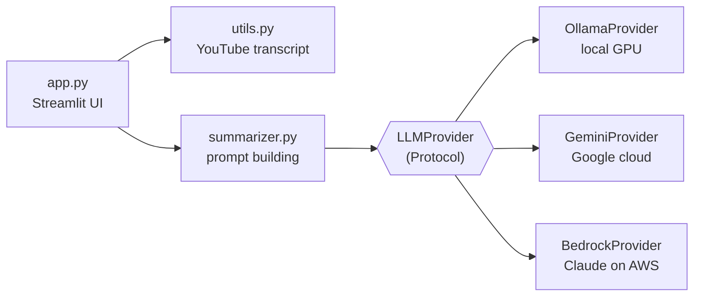

# 🎬 Hybrid YouTube AI Summarizer

[](https://github.com/Liviu1342/hybrid-youtube-ai-summarizer/actions/workflows/tests.yml)

Turn any YouTube video into structured study notes — **100% locally and privately with Ollama**, or **in the cloud with Google Gemini or Claude on Amazon Bedrock**, switchable with one click.


## ✨ Features

- **Hybrid AI engine** – choose between a local model (Ollama, free, private, works offline) and a cloud model (Gemini, faster and larger).
- **Structured output** – TL;DR, main ideas and key concepts explained simply, in English or Romanian.
- **Robust URL parsing** – supports `watch?v=`, `youtu.be`, Shorts, embeds and live links.
- **Friendly error handling** – clear messages for missing subtitles, private videos, unavailable models or network issues.
- **Prompt-injection guard** – the transcript is passed to the model as delimited data, never as instructions.
- **Markdown export** – download the summary as a `.md` file.
- **Three interchangeable AI engines** – Ollama (local), Gemini and Claude Sonnet on Amazon Bedrock (cloud), all behind one `LLMProvider` interface.
- **Live streaming** – the summary appears word by word as the model writes it.

## 🏗️ Architecture



The UI depends only on the `LLMProvider` contract. Providers are created in a single factory (`build_provider`) and injected into `generate_summary`, so adding a new provider (e.g. OpenAI) means writing one class — no UI changes.

## 🛠️ Tech stack

Python 3.10+ · Streamlit · youtube-transcript-api · Ollama (`llama3.1:8b`) · Google Gen AI SDK (Gemini) · Anthropic SDK (Claude on Amazon Bedrock) · python-dotenv

## 🚀 Getting started

### Prerequisites

- Python 3.10 or newer
- [Ollama](https://ollama.com/download) for local mode: `ollama pull llama3.1:8b`
- *(Optional)* a free Gemini API key from [Google AI Studio](https://aistudio.google.com/apikey) for cloud mode

### Installation

```bash
git clone https://github.com/Liviu1342/hybrid-youtube-ai-summarizer.git
cd hybrid-youtube-ai-summarizer
python -m venv venv          # macOS / Linux: python3 -m venv venv
```
> **macOS note:** the built-in `python3` may be version 3.9, which is too old.
>
> If `python3 --version` shows anything below 3.10, install a newer Python
> (e.g. `brew install python@3.13`) and create the environment with
> `python3.13 -m venv venv`.


Activate the virtual environment:

- **Windows (PowerShell):** `.\venv\Scripts\Activate.ps1`
- **macOS / Linux:** `source venv/bin/activate`

Then install the dependencies and create your local configuration:

```bash
pip install -r requirements.txt
cp .env.example .env        # Windows: Copy-Item .env.example .env
```

Edit `.env` and fill in your values (the Gemini key is only needed for cloud mode).

### Run

```bash
streamlit run app.py
```

The app opens at <http://localhost:8501>.

## ⚙️ Configuration

| Variable | Description | Default |
| --- | --- | --- |
| `OLLAMA_HOST` | Address of the Ollama server | `http://localhost:11434` |
| `OLLAMA_MODEL` | Local model to use | `llama3.1:8b` |
| `GEMINI_API_KEY` | Your Gemini API key (**never commit it**) | – |
| `GEMINI_MODEL` | Gemini model name | – |
| `AWS_BEARER_TOKEN_BEDROCK` | Your Amazon Bedrock API key (**never commit it**) | – |
| `AWS_REGION` | AWS region of the Bedrock key | `us-east-1` |
| `BEDROCK_MODEL` | Claude model ID on Bedrock | `anthropic.claude-sonnet-5-5` |

## 📁 Project structure

```text
├── app.py            # Streamlit UI and provider factory
├── summarizer.py     # System prompt and summary generation
├── providers.py      # LLMProvider contract + Ollama and Gemini implementations
├── utils.py          # YouTube URL parsing and transcript download
├── requirements.txt  # Pinned dependencies
└── .env.example      # Configuration template (copy to .env)
```

## 🔒 Security

- Secrets live only in `.env`, which is excluded by `.gitignore`.
- In local mode, no data ever leaves your machine.

## 🗺️ Roadmap

- [x] Remove subtitle noise (e.g. `[Music]`) before summarizing
- [ ] Chunked summaries for very long videos
- [x] Unit tests and CI
